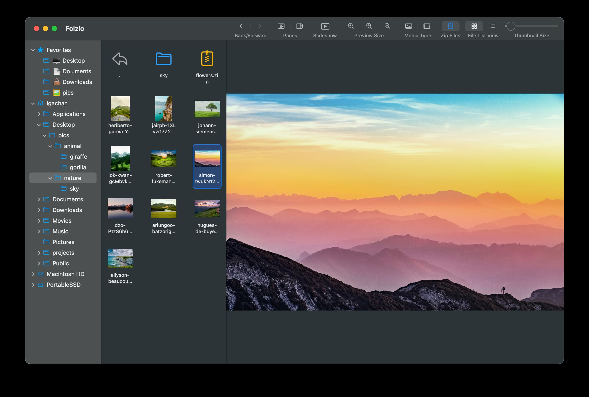
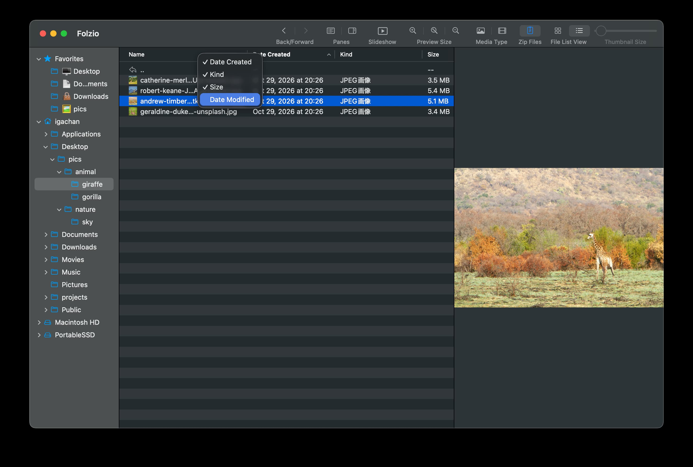
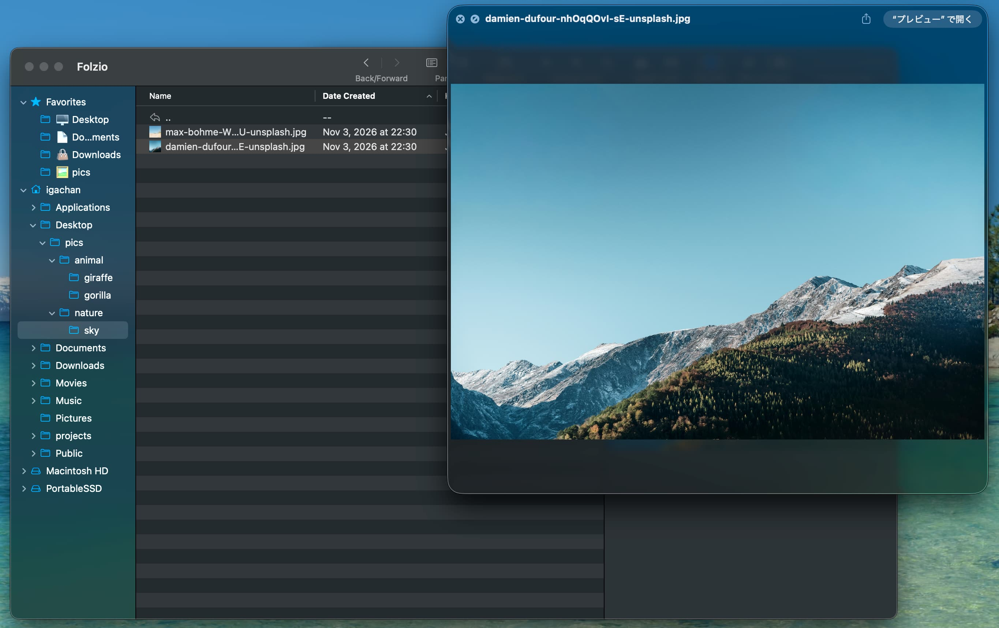
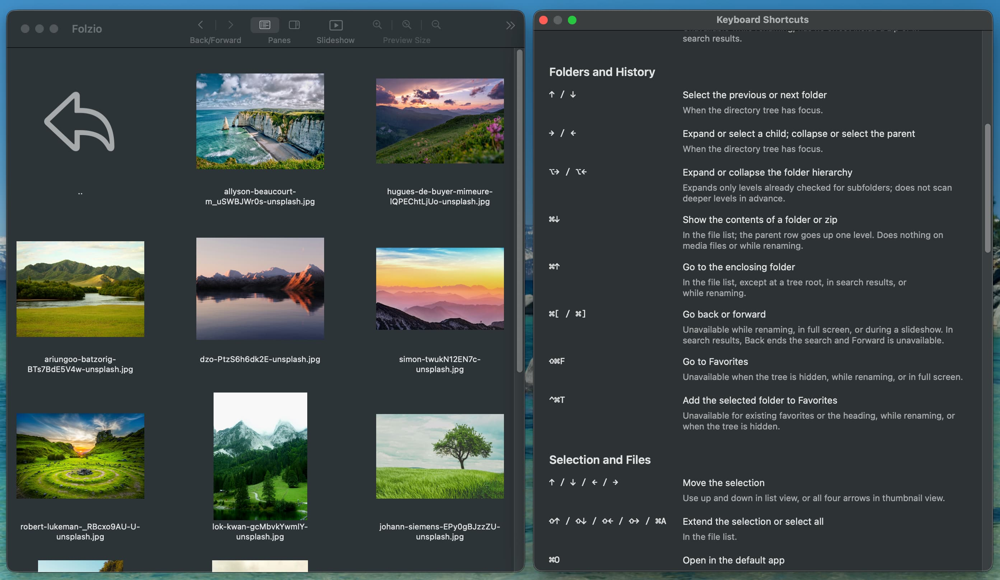

# Folzio

[English](README.md) | 日本語

**フォルダにある画像や動画を、そのまま見て、整理する。**

Folzio は、フォルダ移動・サムネイル一覧・プレビューをひとつのウインドウにまとめた macOS アプリです。
写真・アニメーション画像・動画が混在するフォルダを開いて、内容を確かめながらファイルを整理できます。

macOS 15 以降 · Apple silicon 専用 · 英語・日本語対応 · ネットワーク通信なしでローカルで動作 · [MIT License](LICENSE)

## 主な機能

- **フォルダと内容を一緒に見渡す。** フォルダツリー、サムネイルまたはファイル一覧、選択項目のプレビューを
  3ペインで同時に表示。よく使うフォルダはお気に入りに登録できます。
- **画像も動画も同じ一覧で見る。** 写真、アニメーション GIF、WebP 画像、動画をまとめて閲覧。
  動画の自動再生やループ再生にも対応しています。Space でクイックルック、ダブルクリックで既定のアプリで開けます。
- **見ながら整理する。** macOS で使い慣れたショートカットやドラッグ＆ドロップで、
  ファイルやフォルダのコピー・移動・複製・名前変更・ゴミ箱への移動ができます。その場でのフォルダ作成、
  ツリーで複数のフォルダを選んでのまとめての移動・コピー・ゴミ箱への移動、パス名のコピーにも対応しています。
  Finder や Web ブラウザとのドラッグ＆ドロップもできます。
- **zip の中も閲覧する。** zip 内のフォルダをたどり、画像や動画をプレビューできます。
  中身は読み取り専用。動画は一時ファイルへ展開せず、zip から直接再生します。
- **フォルダをまたいで探す。** ファイル名・フォルダ名（zip ファイルの表示中は zip ファイル名も）で検索し、
  検索結果の中でプレビューやファイルの整理を続けられます。
- **メディアの鑑賞に集中する。** 画像の拡大、プレビューのみ表示、フルスクリーン（プレビューのダブルクリック）、
  動画の5秒戻し・送りに対応。間隔や切り替え効果を選べるスライドショーも楽しめます。
- **自分好みに整える。** ツールバーの並び替え、メニューのショートカットの割り当て変更、リスト形式で表示する列の選択ができます。
  ショートカット一覧は別ウインドウで開いたまま参照できます。

## ダウンロード

アプリは GitHub Releases から入手できます。macOS 15 以降の Apple silicon Mac が必要です。
Intel Mac は対象外です。

1. [Releases ページ](https://github.com/yoshidax/folzio/releases)を開き、目的のリリースから
   `Folzio-vX.Y.Z-macos-arm64.zip` をダウンロードします。
2. ZIP を展開して `Folzio.app` をアプリケーションフォルダへ移動し、開きます。
3. このアプリは Developer ID 署名と Apple の公証を受けていません。macOS にブロックされた場合、配布元を信頼できると判断したうえで、
   システム設定 → プライバシーとセキュリティの **このまま開く** を選び、確認します。
   [Apple の案内](https://support.apple.com/ja-jp/102445)も参照してください。

ソースから試す場合は、[ビルドと起動の手順](docs/development.ja.md)を参照してください。
ビルドには Swift 6 ツールチェーンを含む Xcode が必要です。

## はじめに

1. Folzio を起動し、左のツリーでフォルダを選びます。
2. 中央の画像や動画を選ぶと、右にプレビューが表示されます。矢印キーで一覧を移動できます。
3. ⌘1 / ⌘2 でサムネイル形式とリスト形式を切り替えます。ファイルをフォルダへドラッグすると移動し、
   ドロップ時に ⌥ を押すとコピーします。

表示言語を変えるには、設定（⌘,）の「言語」を選びます。初期値は英語です。
フォルダにアクセスできない場合は、システム設定 → プライバシーとセキュリティ → ファイルとフォルダで Folzio に許可してください。
ツールバーは初期状態では非表示です。⇧⌘T で表示し、右クリックでボタンをカスタマイズできます。

## よく使うショートカット

以下は既定のキーです。メニューのコマンドのキーは、設定（⌘,）の「ショートカット」で変更できます。

| 操作 | 既定のショートカット |
|------|----------------|
| ショートカット一覧を開く | ⌘/ |
| サムネイル形式／リスト形式 | ⌘1 / ⌘2 |
| ツールバーを表示／隠す | ⇧⌘T |
| ファイル名・フォルダ名の検索 | ⌘F |
| フォルダを開く／1つ上の階層へ戻る | ⌘↓ / ⌘↑ |
| 新規フォルダ | ⇧⌘N |
| 選択したメディアをクイックルックで確認 | Space |
| 画像を拡大／縮小／表示領域に合わせる | ⌘+ / ⌘− / ⌘0 |
| 動画を5秒戻す／送る | `<` / `>` |
| フルスクリーンにする／戻す | ⌃⌘F |
| スライドショーを開始／終了 | ⇧⌘S / Esc |
| zip ファイルを表示／隠す | ⌃⌘Z |

「ファイル > ショートカット一覧…」から、目的別の操作一覧を開けます。
独立した別ウィンドウなので、参照しながらメインウィンドウを操作できます。一覧は ⌘W で閉じられ、
親ウィンドウを閉じると一覧も閉じます。

その他のショートカット、設定、詳しい動作は[ユーザーガイド](docs/usage.ja.md)を参照してください。

## 対応形式と主な制約

- **画像:** JPEG、PNG、GIF、WebP。アニメーション WebP の再生は macOS の対応状況に依存し、
  非対応の場合は先頭フレームを表示します。
- **動画:** MP4、MOV。再生できるコーデックは macOS の対応状況に依存します。
- **zip:** 対応メディアの閲覧とプレビューができます。zip 内の編集はできず、
  名前の検索も zip 内は対象外です（表示中の zip ファイル自体は検索できます）。
  zip ファイルは初期状態では非表示で、⌃⌘Z で表示できます。

## ガイド

- [ユーザーガイド](docs/usage.ja.md) — フォルダ移動、お気に入り、検索、拡大・縮小、スライドショー、ファイル操作、カスタマイズ。
- [開発・検証ガイド](docs/development.ja.md) — ソースからのビルド、自動テスト、フィクスチャ、プロジェクト構成。

## プロジェクトの運営方針

Folzio は作者個人が開発・保守するプロジェクトです。
プルリクエスト、バグ報告、機能要望を含む、外部からの貢献は受け付けていません。
Issue は作者自身の管理用です。

MIT License のもとで、利用・改変・フォーク・再配布できます。

## ライセンス

[MIT License](LICENSE)
