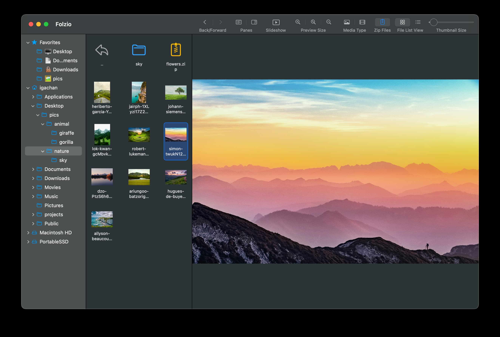
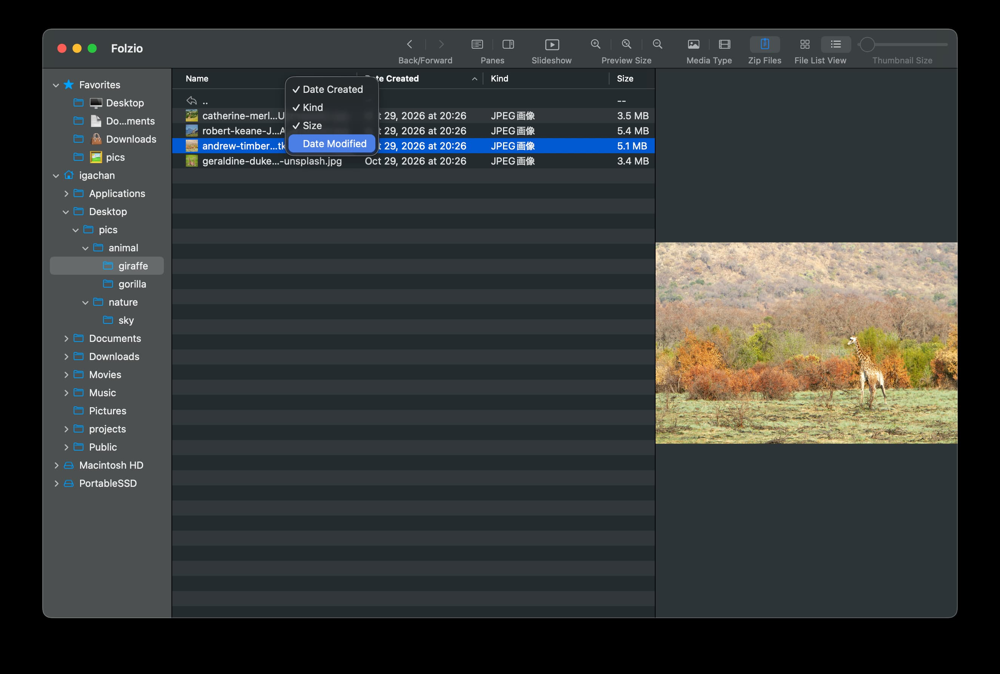
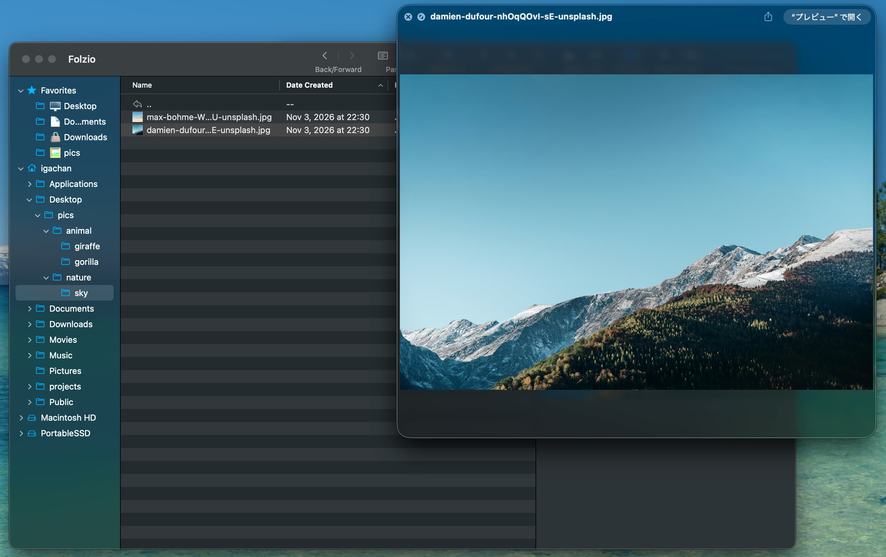
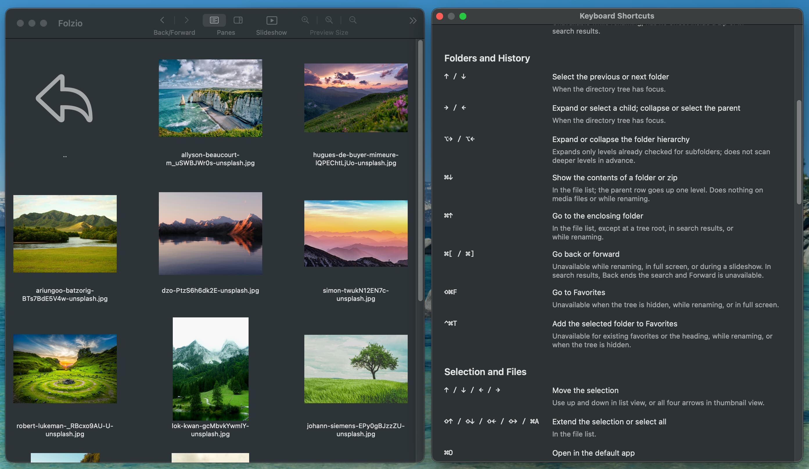

# Folzio

English | [日本語](README.ja.md)

**Browse and organize your images and videos, right in their folders.**

Folzio is a native macOS app that brings folder navigation, thumbnails, and previews together in one window.
Browse a folder of photos, animated images, and video clips, then organize files as you view them.

macOS 15 or later · Apple silicon only · English and Japanese · Works locally without network communication · [MIT License](LICENSE)

## Features

- **Keep the whole folder in view.** Navigate folders, scan thumbnails or a file list, and preview the selected item
  side by side in a three-pane layout. Save frequently used folders as favorites.
- **View images and videos together.** Browse photos, animated GIFs, WebP images, and videos in the same list,
  with video autoplay and looping available. Press Space for Quick Look, or double-click to open a file in its default app.
- **Organize while you browse.** Copy, move, duplicate, rename, and trash files and folders with familiar macOS
  shortcuts and drag and drop. Create folders on the spot, select several folders in the tree to move, copy,
  or trash them at once, and copy the full path of a file or folder. Drag and drop also works with Finder
  and web browsers.
- **Save images from a browser.** Drop an image onto a folder, or choose “Copy Image” in the browser and press ⌘V
  in Folzio. You can also drag photos and videos from Photos. Cancel a pending reception with ⌘. or its Cancel button.
- **Look inside zip archives.** Browse folders and preview images and videos inside zip files.
  Archive contents are read-only; videos play directly from the archive without temporary extraction.
- **Find files across folders.** Search file and folder names (and zip file names while zip files are shown),
  then preview and organize matching items without leaving the results. Type in the toolbar search field to filter the list you are viewing by name.
- **Focus on your media.** Zoom images, switch to preview-only or full-screen viewing (double-click the preview),
  skip videos back or forward 5 seconds, or start a slideshow with adjustable timing and transitions.
- **Make it your own.** Rearrange the toolbar, reassign menu shortcuts, and choose which columns the list view shows.
  Keep the shortcut reference open in its own window while you work.

## Download

The app is available from GitHub Releases. It requires macOS 15 or later on an Apple silicon Mac;
Intel Macs are not supported.

1. Open the [Releases page](https://github.com/yoshidax/folzio/releases) and download
   `Folzio-vX.Y.Z-macos-arm64.zip` from the desired release.
2. Unzip the file and move `Folzio.app` to Applications, then open it.
3. The app is not signed with a Developer ID or notarized by Apple. If macOS blocks it, and you trust the download,
   open System Settings → Privacy & Security and choose **Open Anyway**, then confirm. See
   [Apple's instructions](https://support.apple.com/en-us/102445).

To try it from source, see the [build and launch instructions](docs/development.md).
Xcode with the Swift 6 toolchain is required to build the app.

## Get Started

1. Launch Folzio and choose a folder in the tree on the left.
2. Select an image or video in the center to preview it on the right. Use the arrow keys to browse the list.
3. Switch between thumbnails and list view with ⌘1 / ⌘2. Drag files onto a folder to move them;
   hold ⌥ when dropping to copy instead.

To change the interface language, open Settings (⌘,) and choose Language. English is the default.
If a folder is not accessible, allow Folzio access in System Settings → Privacy & Security → Files and Folders.
The toolbar is hidden by default; show it with ⇧⌘T, and right-click it to customize the buttons.

## Useful Shortcuts

The keys below are the defaults. You can change the shortcut of a menu command in Settings (⌘,) → Shortcuts (ショートカット).

| Action | Default shortcut |
|--------|----------|
| Open the shortcut reference | ⌘/ |
| Thumbnail view / list view | ⌘1 / ⌘2 |
| Show / hide the toolbar | ⇧⌘T |
| Search file and folder names | ⌥⌘F |
| Filter the displayed list by name | ⌘F |
| Open a folder / go up one level | ⌘↓ / ⌘↑ |
| Create a new folder | ⇧⌘N |
| Cancel receiving images or videos | ⌘. |
| Quick Look the selected media | Space |
| Zoom an image in / out / fit to view | ⌘+ / ⌘− / ⌘0 |
| Skip a video back / forward 5 seconds | `<` / `>` |
| Enter / exit full screen | ⌃⌘F |
| Start / end a slideshow | ⇧⌘S / Esc |
| Show / hide zip files | ⌃⌘Z |

Open File → Keyboard Shortcuts… (ショートカット一覧…) for a reference grouped by purpose.
It opens in a separate window so you can keep using the main window. Close the reference with ⌘W;
closing its parent also closes the reference.

See the [user guide](docs/usage.md) for more shortcuts, settings, and detailed behavior.

## Supported Formats and Limits

- **Images:** JPEG, PNG, GIF, and WebP. Animated WebP playback depends on macOS support;
  when unsupported, the first frame is displayed.
- **Videos:** MP4 and MOV. Playback depends on the codecs supported by macOS.
- **zip archives:** Browse and preview supported media. Archive contents cannot be edited,
  and name searches do not look inside archives (zip files themselves can be found while shown).
  Zip files are hidden by default; show them with ⌃⌘Z.

## Guides

- [User guide](docs/usage.md) — folder navigation, favorites, search, zoom, slideshows, file operations, and customization.
- [Development and verification](docs/development.md) — source builds, automated tests, fixtures, and project structure.

## Project Policy

Folzio is a personal project developed and maintained by its author.
External contributions, including pull requests, bug reports, and feature requests, are not accepted.
Issues are reserved for the maintainer's own tracking.

You are welcome to use, modify, fork, and redistribute the project under the MIT License.

## License

[MIT License](LICENSE)
